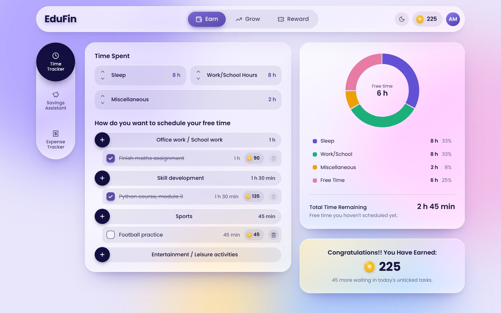
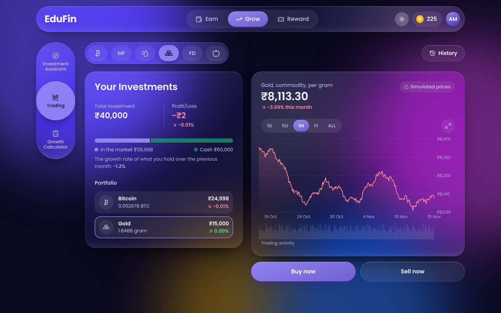
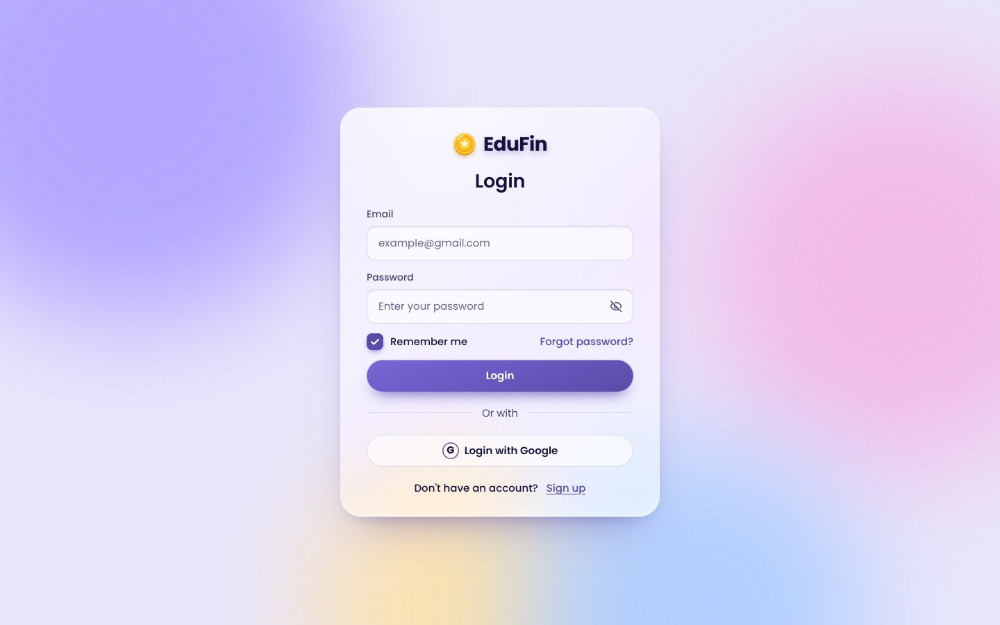

# EduFin

A money-habits app for students. You earn coins by planning your free time and staying
under a daily spending goal, practise investing with virtual cash, and spend coins on
offers. React frontend, Flask + MongoDB backend.



| Trading (dark theme) | Login |
|---|---|
|  |  |

## Run it

You need Python 3.10+ and Node 18+. MongoDB is optional for a first look.

**1. Backend** (first terminal)

```
cd backend
python -m venv .venv
.venv\Scripts\activate          # Windows.  macOS/Linux: source .venv/bin/activate
pip install -r requirements.txt
copy .env.example .env          # macOS/Linux: cp .env.example .env
python app.py
```

Open `backend/.env` and set:

- `JWT_SECRET` to a long random string. The file shows a one-line command that makes one.
- `EDUFIN_DB=memory` if you don't have MongoDB installed. Everything works, but all data
  disappears when the server stops. With MongoDB running, leave it as `mongo`.

The API starts on http://localhost:5050.

**2. Frontend** (second terminal)

```
cd frontend
npm install
npm run dev
```

Open http://localhost:5173 and create an account.

**As one process:** run `npm run build` in `frontend`, then `python app.py` in `backend`
serves the whole app on http://localhost:5050.

## What's in it

The layout follows the Figma: Earn, Grow and Reward across the top, Balance and Profile
on the right, and a tall pill on the left whose dark blob slides to the current tool.

| Section | Screen | What it does |
|---|---|---|
| Earn | Time Tracker | Set hours for sleep, work/school and miscellaneous. Schedule tasks into the free time that's left, in four categories. Tick a task to collect its coins. |
| Earn | Savings Assistant | Coins earned today and this month, change against yesterday and last month, rupees saved, tips drawn from your own spending, and a calendar to look back at any day. |
| Earn | Expense Tracker | Set today's goal, list planned expenses in four categories, tick each one when paid. Close the day at or under the goal to collect a bonus. |
| Grow | Investment Assistant | Enter an amount, risk level and target return; get a suggested split across stocks, mutual funds, gold and crypto. |
| Grow | Trading | Paper trading with ₹1,00,000 of virtual cash across six assets, with price charts over five time ranges, buy and sell, a portfolio and trade history. |
| Grow | Growth Calculator | Compound interest with a year-by-year chart. |
| Reward | Offers | Redeem coins for offers; each redemption produces a code. |
| | Balance | Coin balance, level, coin history, and moving coins into trading cash. |
| | Profile | Picture, name, phone, email, password, log out. |

Also: light and dark themes (the moon button), layouts for phone and tablet, keyboard
focus styles, and reduced motion when the device asks for it.

### How coins work

| Action | Coins |
|---|---|
| Finish a work/school or skill task | 1.5 per minute |
| Finish a sports task | 1 per minute |
| Finish a leisure task | 0.5 per minute |
| Close a day at or under your spending goal | 100, plus 0.4 per rupee saved, up to 500 |
| Close a day over the goal | 0 |

- A day you forget to close is closed for you the next time you open the app, and pays
  its bonus only if you logged at least one expense.
- Unticking a task takes its coins back. If you've already spent them, it stays ticked.
- Levels go by lifetime coins: Basic, Silver at 2,500, Gold at 10,000.
- 1 coin buys ₹1 of virtual trading cash (one way).

These numbers live at the top of `backend/edufin/routes_earn.py`, `routes_wallet.py` and
`core.py`.

## Things to know

- **Prices are simulated.** There is no market data feed. `backend/edufin/market.py`
  generates each asset's price from a formula, so the charts are for practice only.
- **Offers are samples.** The three offers come from the design. No retailer is
  connected, so the codes are demonstration codes. To change the catalog, edit the
  `rewards` collection (or `SAMPLE_REWARDS` in `db.py` before the first run).
- **Investment suggestions are illustrative.** They blend fixed assumed returns
  (stocks 12%, mutual funds 9%, gold 7%, crypto 20% a year). Not financial advice.
- **Password reset codes are printed in the backend terminal**, because no email service
  is connected. Replace `deliver_reset_code()` in `routes_auth.py` to send real email.
- **Google sign-in needs a client ID.** Put a Google OAuth web client ID in
  `GOOGLE_CLIENT_ID`. Without it, the Google buttons explain that it isn't set up.
  This path was written but not run against Google.
- **Tested against an in-memory MongoDB**, not a real MongoDB server. The queries used
  are basic ones, but run the tests and click through once after connecting your own.
- **Not included:** login rate limiting, email verification, HTTPS setup.

## Tests

```
cd backend
python -m pytest
```

27 tests cover accounts, password reset, the time tracker, expenses and bonuses, savings,
rewards, coin conversion, the portfolio suggestions, the market and trading.

## API

Every route except the first block needs `Authorization: Bearer <token>`. Errors come
back as `{"error": "message"}`.

| Route | Purpose |
|---|---|
| `POST /api/auth/register`, `/login`, `/google`, `/forgot`, `/reset` | Accounts |
| `GET /api/config`, `/api/health` | Public settings, health check |
| `GET /api/me` · `PUT /api/profile`, `/profile/email`, `/profile/password` | Profile |
| `GET, PUT /api/time` · `POST /api/time/tasks` · `PATCH, DELETE /api/time/tasks/<id>` | Time Tracker |
| `GET /api/expenses` · `PUT /api/expenses/goal` · `POST /api/expenses/items` · `PATCH, DELETE /api/expenses/items/<id>` · `POST /api/expenses/close` | Expense Tracker |
| `GET /api/savings`, `/api/savings/calendar` | Savings Assistant |
| `POST /api/invest/suggest` | Investment Assistant |
| `GET /api/market`, `/api/market/<code>/history` · `GET /api/portfolio`, `/api/trades` · `POST /api/trade` | Trading |
| `GET /api/rewards` · `POST /api/rewards/<id>/redeem` | Rewards |
| `GET /api/balance` · `POST /api/balance/convert` | Balance |

## Project layout

```
backend/
  app.py                 start the API
  .env.example           settings to copy into .env
  edufin/
    __init__.py          builds the Flask app, error handling, serves the built frontend
    config.py            reads settings from the environment
    db.py                MongoDB connection, indexes, sample rewards
    core.py              validation, dates, passwords, login tokens, coin ledger
    market.py            simulated prices
    routes_auth.py       sign up, log in, Google, password reset, profile
    routes_earn.py       time tracker, expense tracker, savings assistant
    routes_grow.py       investment assistant, market, trading
    routes_wallet.py     balance and rewards
  tests/test_api.py
frontend/
  src/
    App.jsx              routes
    api.js               API client and login token
    auth.jsx             signed-in user
    hooks.js  fx.js  format.js
    components/          Shell (top bar, side pill), ui (inputs, modal, coin, toasts), Donut, Planner
    pages/               one file per screen
    styles/app.css       the whole look: colours, glass, layout
```

## What changed from the earlier draft

| Problem | Now |
|---|---|
| Five pages were imported but never written, so the app didn't compile | All eleven screens exist and build |
| The backend stopped partway through task completion | Every route group is finished and tested |
| IDs were passed to MongoDB as strings, so lookups found nothing | Converted with `ObjectId`; a malformed ID returns 404 |
| The JWT secret was hardcoded | Read from `JWT_SECRET` in `.env` |
| `init_sample_data()` was never called | Indexes and sample rewards are set up on every start |
| `activeClassName` (removed in react-router v6) and missing react-feather icons | react-router v6 `NavLink`, icons from lucide-react |
| Left sidebar | Top navigation with the sliding side pill, as in the Figma |
| Create React App | Vite |
